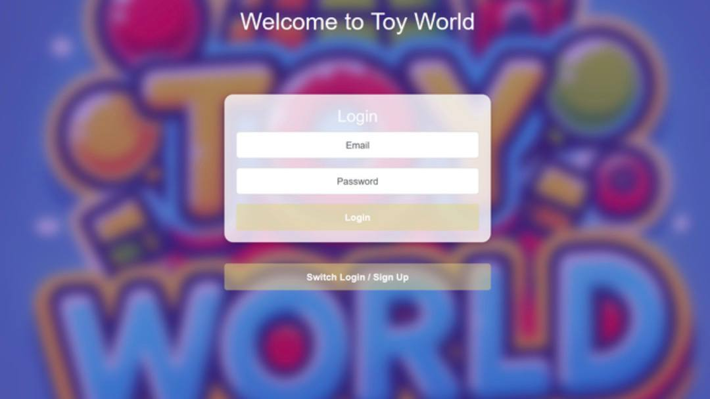
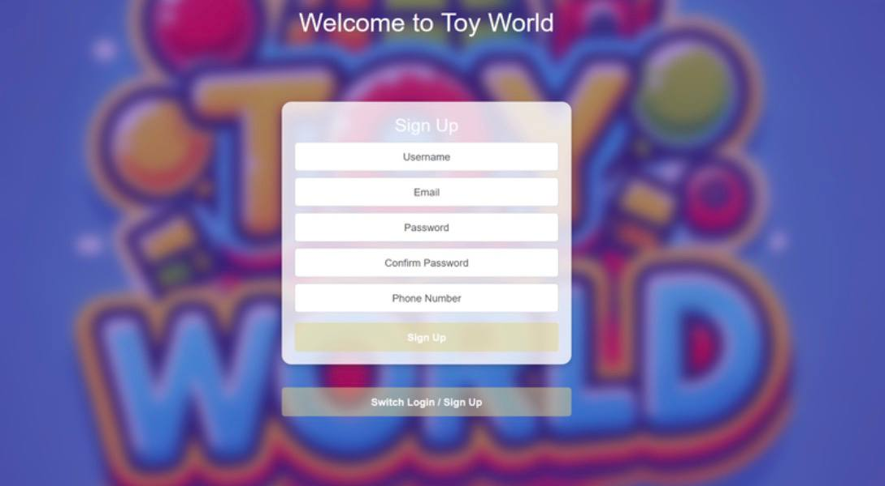
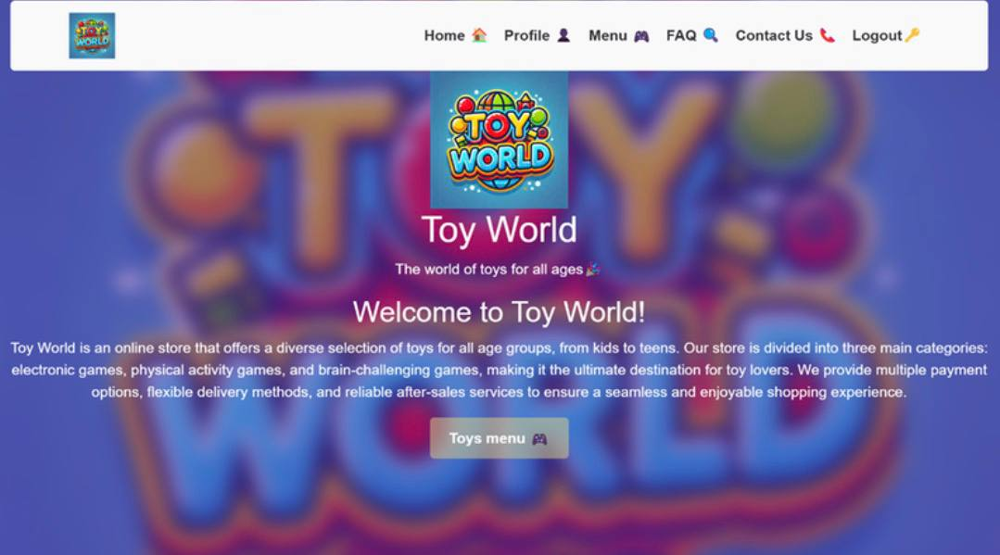
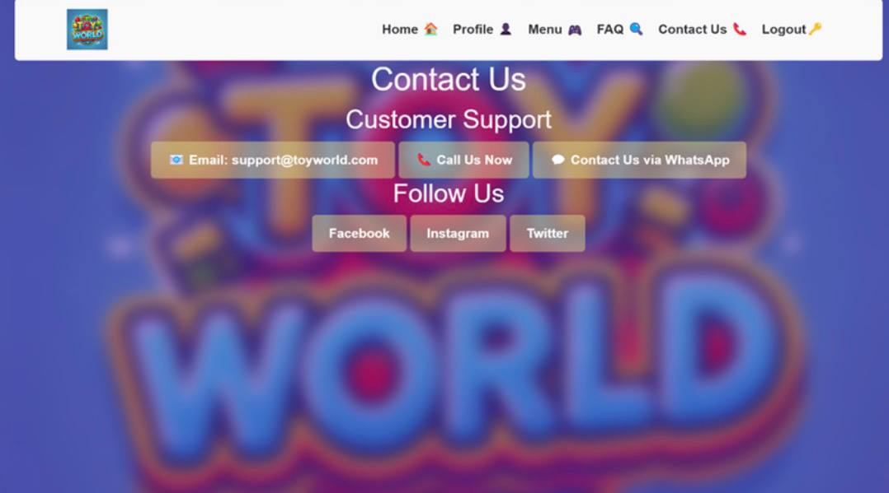
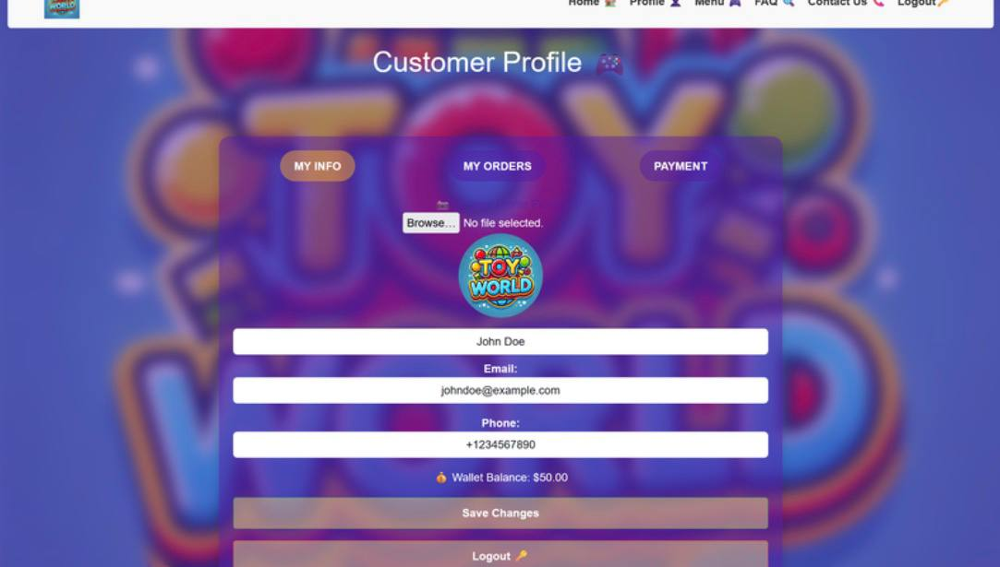
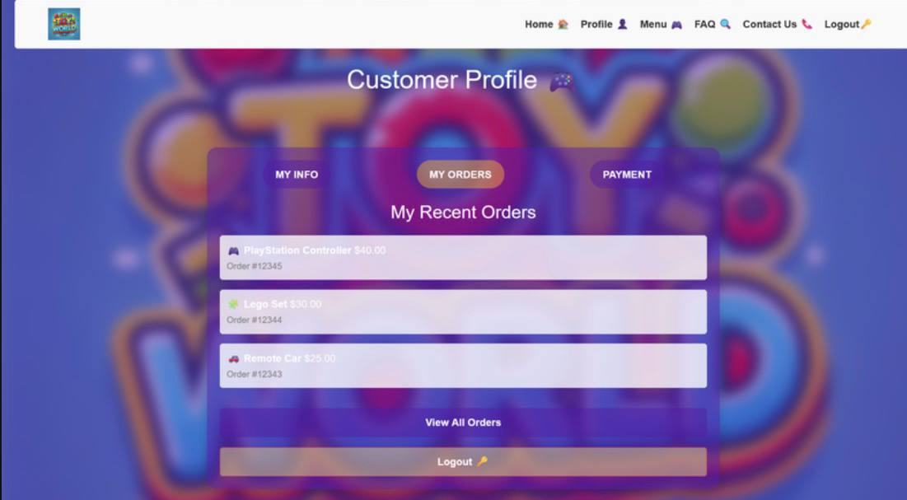

# 🎮 Toy World

Toy World is a simple e-commerce website for selling toys, developed using PHP, MySQL, HTML, CSS, and Bootstrap. The platform allows users to browse products, manage their shopping cart, complete purchases, and contact customer support.

---

## ✨ Features

- 🏠 User-friendly Home Page
- 🧸 Browse available toys and products
- 🛒 Shopping Cart Management
- 💳 Secure Checkout Process
- 👤 User Profile Page
- 📞 Customer Support
- 📱 Fully Responsive Design with Bootstrap

---

## 🛠 Technologies Used

- PHP
- js
- MySQL
- HTML5
- CSS3
- Bootstrap 5

---

## 📂 Database Setup

Create a new database:

CREATE DATABASE toyworld;

Then import the provided database.sql file into your database.

### Database Tables

- users
- orders

---

## 🚀 Installation

### 1. Clone the Repository

git clone https://github.com/your-username/toy-world.git

### 2. Move the Project

Copy the project folder to your local server directory:

- XAMPP → htdocs
- WAMP → www

### 3. Import Database

- Open phpMyAdmin
- Create a database named toyworld
- Import the database.sql file

### 4. Start Services

Run:

- Apache
- MySQL

### 5. Open the Project

Visit:

http://localhost/toy-world

---

## 📸 Some of the Screenshots:

### Login page 

### Sign up page 

### Home Page

### Contact us or Support customer page 

### Customer profile page

### Customer profile Recent order page

### Customer profile Payment method

---

## 📞 Contact

If you have any questions or need support:

📧 Email: support@toyworld.com

📱 Phone: +9665569865876

💬 WhatsApp: +9665569865876

---

## 📄 License

This project is created for educational and learning purposes.
